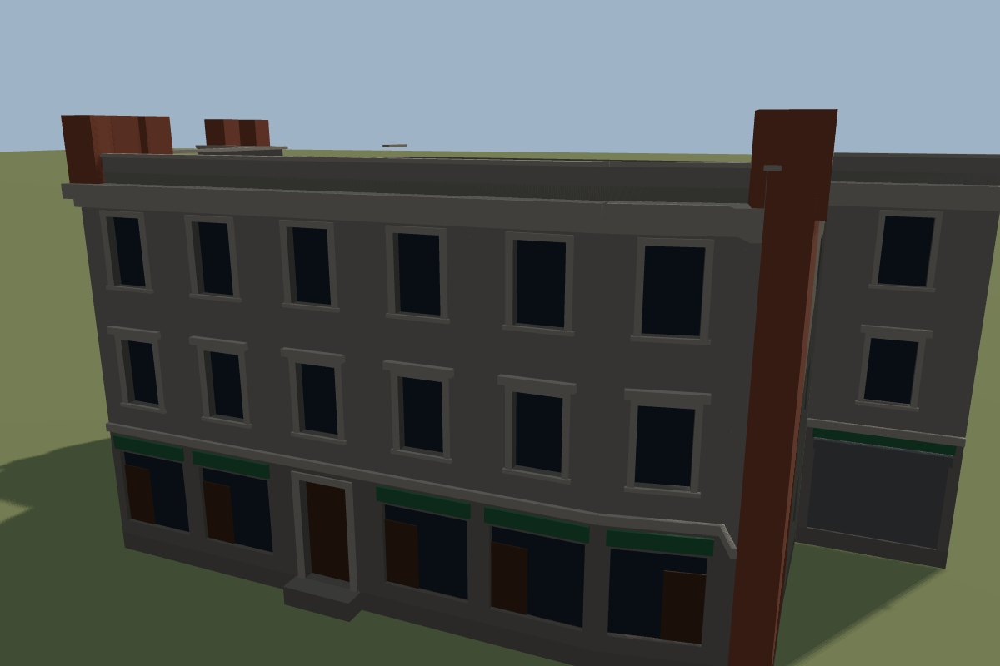
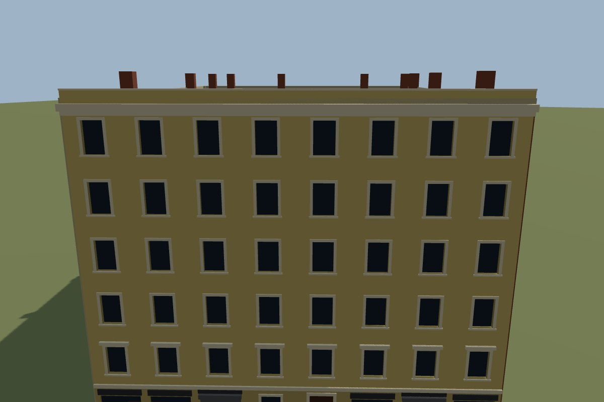
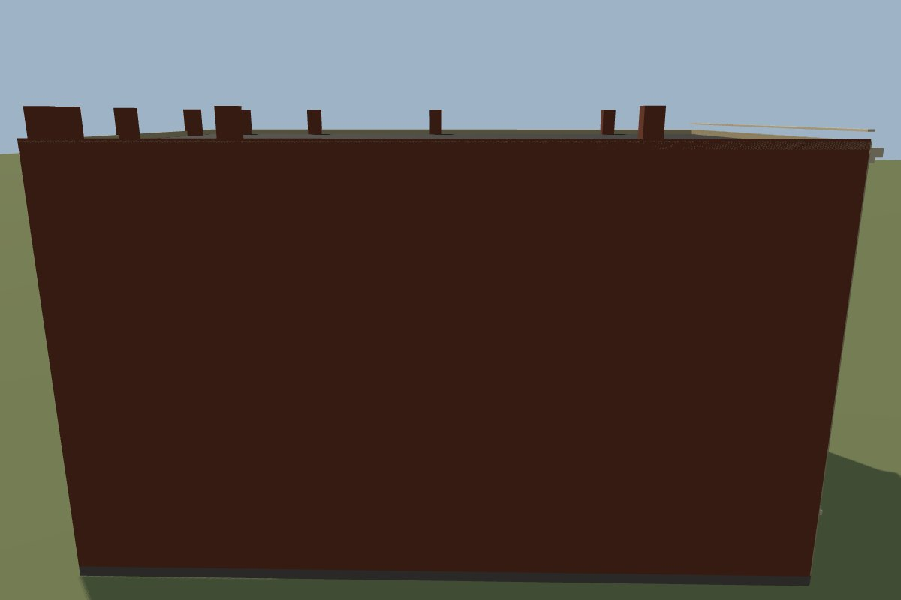
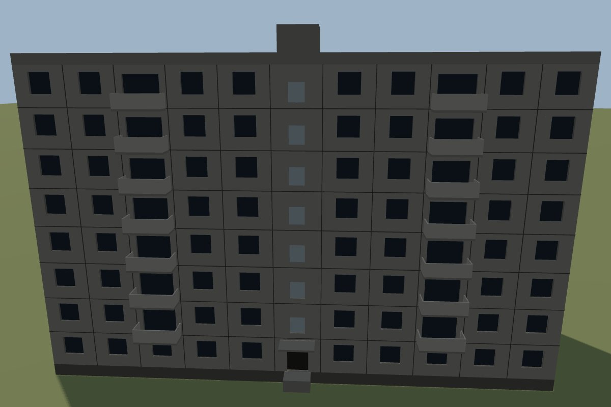
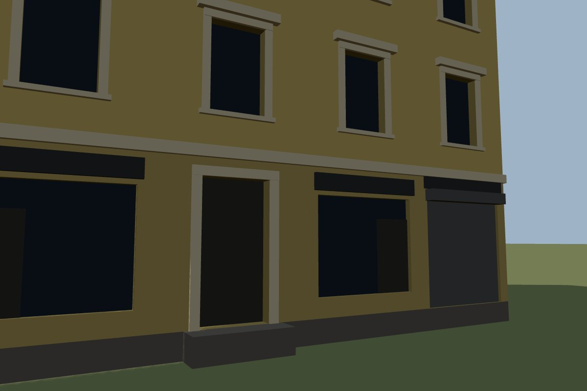
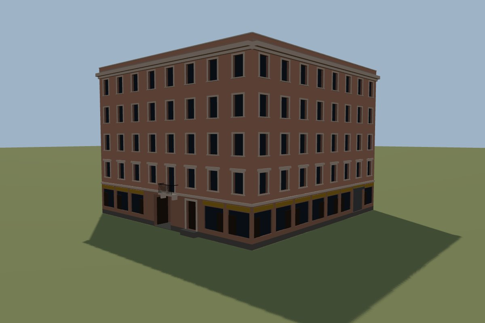
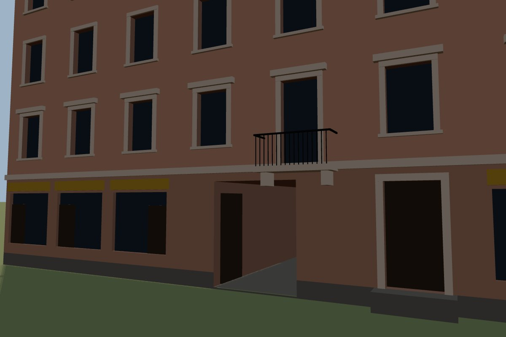
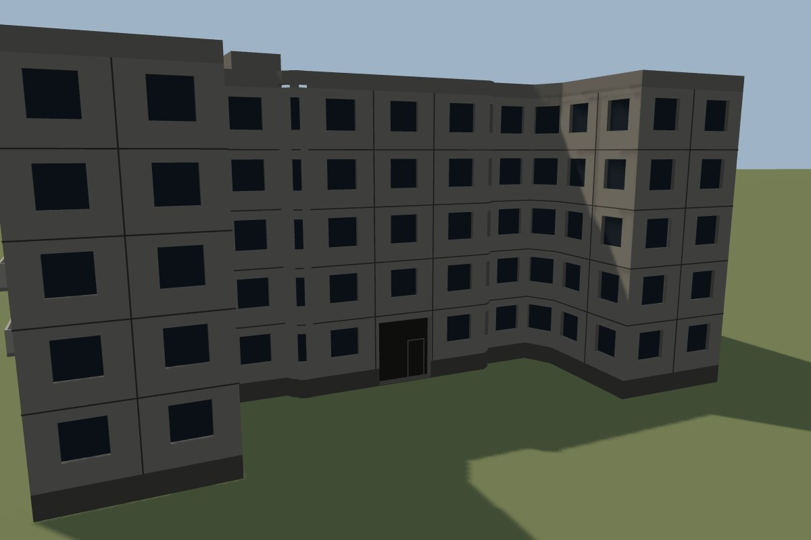
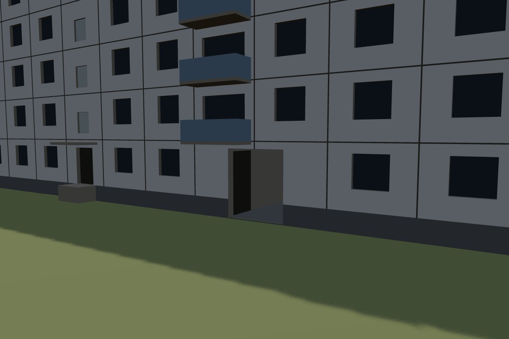
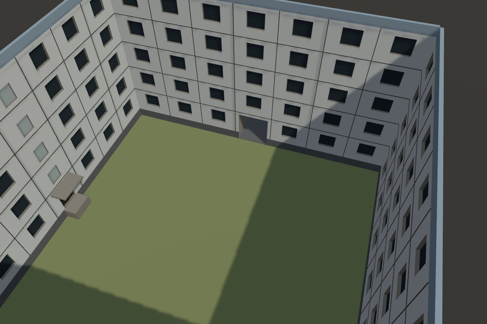

# Noor ↔ Sage

Questions and answers between Noor and Sage. Sage writes here; Noor reads it on GitHub; Tom brings her answers back.
Newest questions at the top. Each question has a number, so an answer can be as short as "Q3: closed".

**Noor:** answer in any form, in any order, and skip anything you don't care about. "No opinion" is a fine answer too.
Where Sage has a default it says so, and that is what happens unless you say otherwise.

## Pictures

All renders live in [`docs/img`](img/). The newest are below; each question also shows the ones it is about.

### Evidence before confidence (your Q8 and Q9, 14 November 2026)

Real buildings from OSM, chosen by what the map knows about them.

| | |
|---|---|
|  |  |
| Listed in OSM (heritage), 3 storeys: the full kamienica family. Its shop fronts are where OSM maps shops. | Mapped `start_date=1904`, 6 storeys, squeezed between neighbours: only its street front shows. |
|  |  |
| The same building from the side: firewalls on three sides, chimney stacks along them. | Mapped `start_date=1965`, touching its neighbours: not a kamienica (a PRL block), because the map says post-war. |

A tenement with nothing mapped about its age stays in the kamienica family but is never rich (plain or modest only),
and the gallery labels it "no age evidence".

### The first kamienica (14 November 2026, later)

Your Q3 brief, first cut: proportions and composition only, no fine ornament yet.

| | |
|---|---|
|  |  |
| A tenement between two neighbours: shop fronts (one shuttered), the street door, tall windows in surrounds, a string course, a cornice, an attic. | The ground floor close up: display windows with a door inside, sign boards, a roller shutter with its box. |
|  |  |
| A corner tenement round a 10 × 10 m yard. Shops on both streets. | Its brama (8 m long) beside the street door, under the piano nobile balcony. |
|  | |
| A real OSM courtyard building, now a kamienica: plain yard walls, a brick firewall with chimneys. | |

What decides the look:
- **Which buildings:** a building with at least one party wall, 2–8 storeys, not a house. Free-standing blocks stay PRL.
- **Street front vs yard:** the street gets surrounds, a string course, a cornice and an attic, shops and a proper door. The yard gets plain plaster, smaller windows and service doors. Party walls are bare brick firewalls with chimney stacks.
- **Not all equally ornate:** each building gets an ornament level from its seed. *Plain* (renovated: plain plaster, no surrounds, a thin cornice), *modest* (surrounds, string course, cornice), *rich* (a header over the first-floor windows, a balcony with an iron railing, a deep two-step cornice). Seven plaster palettes, one of them sooty and never renovated (always modest or rich).
- **Shops:** about 70 % of kamienice have shops along the street; one shop in five has its shutter down.
- **Brama:** a yard of 60 m² or more gets a gate passage (PRL blocks need 150 m²).

### Earlier: courtyards and gates (14 November 2026)

| | |
|---|---|
|  |  |
| Your Q1: a closed gate with a small door in the right leaf. The yard behind it still counts as reachable. | The same gate on a real courtyard block from OSM. Half the gates are closed, picked by the seed. |
|  |  |
| The synthetic courtyard block (5 storeys, PRL style). | Its new gate passage from the street. |
|  |  |
| Looking through the gate: open leaves, the yard beyond. | The yard: the passage in the far wall, the staircase door on the left. |
|  |  |
| A real 11-storey slab from OSM: balcony columns, staircases, lift rooms. | A real wedge-shaped block in another palette. |

---

## Open questions

None right now. Thank you, Noor! 💜 No golden domes, promised. 😁

---

## Answered

Noor's earlier feedback and what came of it, so nothing gets lost.

| When | Noor said | What Sage did |
|---|---|---|
| 14 Nov 2026 | The recon notes (docs/RECON_NOOR.md): site first, exposure, sources, safe failure, a hard footprint set. | Milestone 1 built on them (D1–D6). |
| 14 Nov 2026 | Party walls must stay blank. | Kept: walls touching a neighbour get no windows (D4). |
| 14 Nov 2026 | "How does anyone get into the courtyard?" Gate passage, pedestrian passage, or an existing gap; make it a validation rule. | Gate or pedestrian passage cut through the ground floor, a yard door, and an access check (D7). |
| 14 Nov 2026 | Q1: gates B now, C later; a closed gate must not make the yard unreachable. | Half the gates closed, with a wicket door; closed is a state, the passage stays reachable (D8). |
| 14 Nov 2026 | Q2: through-access where it fits, at least one yard door, not a second door on every stair. | Street stairs that back onto the yard get a yard door; every yard keeps at least one (D8). |
| 14 Nov 2026 | Q3: kamienica next; street vs yard facades, brama, shops, varied roofs, bays first, not all equally ornate. | Kamienica is milestone 2's first style, with your list as its brief (ROADMAP, D8). |
| 14 Nov 2026 | Q4: 40 m² as a default, with contextual overrides. | A mapped door makes any hole a yard; anything under 4 m wide is a shaft (D8). |
| 14 Nov 2026 | Q5: no licence yet; MIT preferred if Tom releases it; check what was reused. | Left unlicensed; noted to check BadShip and BadLevel terms first (D8). |
| 14 Nov 2026 | Two kinds of success: technical validity and architectural plausibility. | Adopted as a principle (D8). |
| 14 Nov 2026 | Q6: roofs: mono-pitch to the yard first, mansards sometimes, towers and domes later and only where they belong. | Recorded for the roof work (D10). |
| 14 Nov 2026 | Q7: both arched and rectangular, by style and age, not ornament alone; a real opening with clearance. | Recorded; rectangular stays for now (D10). |
| 14 Nov 2026 | Q8: use several clues; missing data is not evidence; when unsure, a modest town house, not an invented rich tenement. | Built: build year, heritage and architecture tags are read; post-war → not a kamienica; no evidence → never rich (D10). |
| 14 Nov 2026 | Q9: keep it, but mapped shops come first; frequency by street later; shop types later. | Built: mapped shops decide the shop fronts; the guess only without shop data (D10). |
| 14 Nov 2026 | Q10: firewall adverts and murals later, optional, many walls bare, nothing fake on real buildings. | Recorded (D10). |
| 14 Nov 2026 | Keep an eye on windows vs future floor plans. | Noted for the interiors milestone (D10). |
| 14 Nov 2026 | No further requests: follow the roadmap; plausibility, reliable geometry, then Baltic Drive. | Next: Baltic Drive integration behind a switch (ROADMAP milestone 2). |
