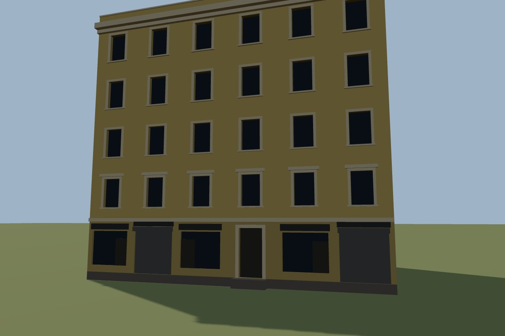
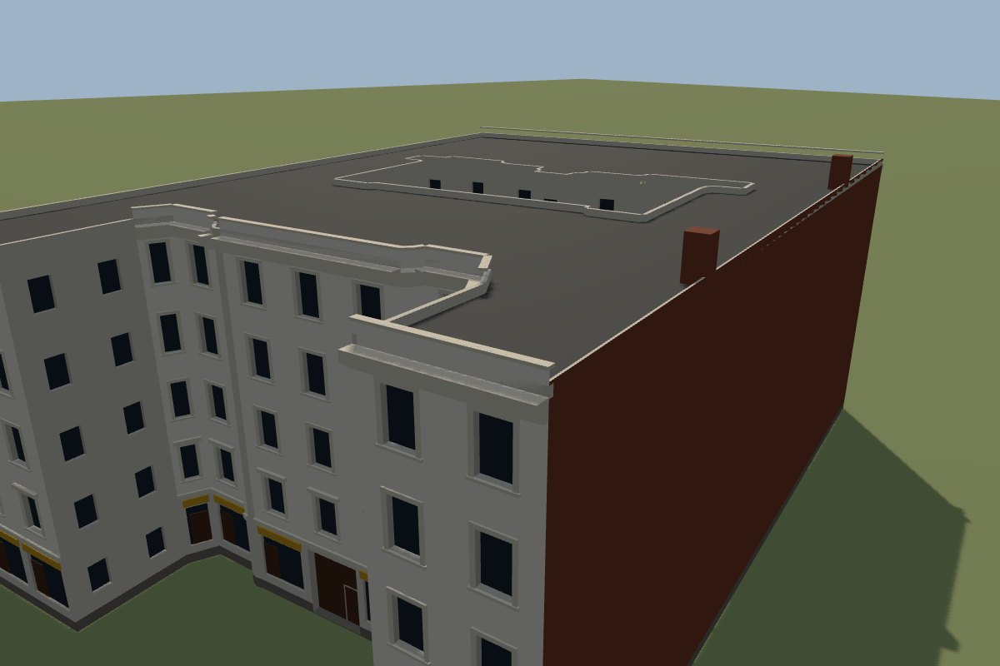
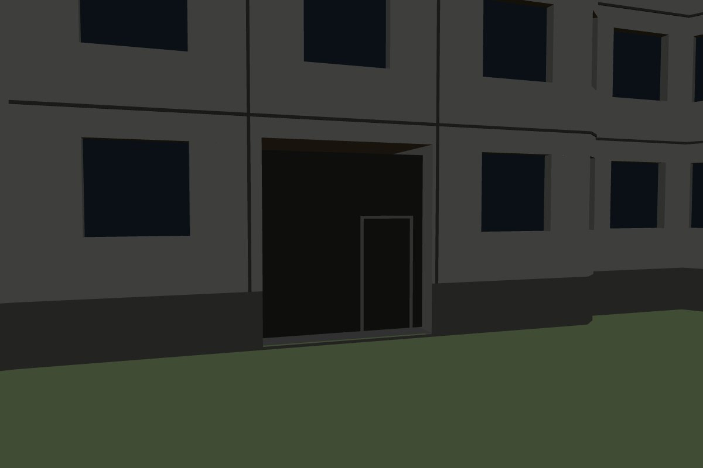
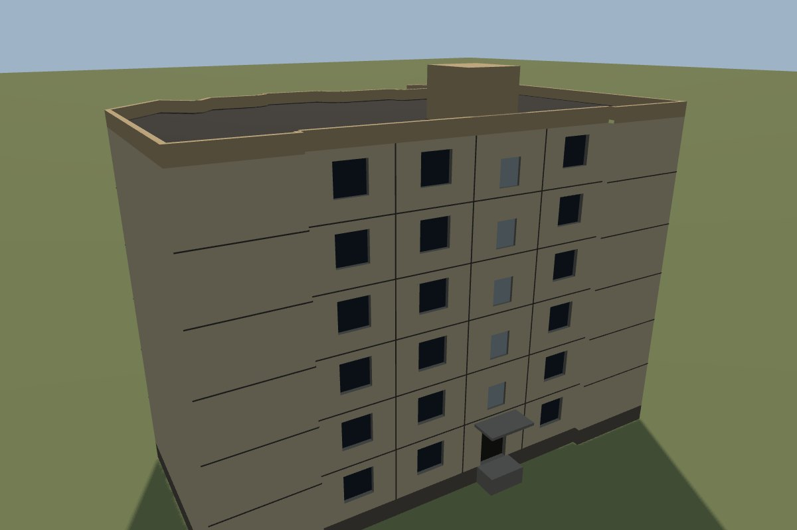

# Noor ↔ Sage

Questions and answers between Noor and Sage. Sage writes here; Noor reads it on GitHub; Tom brings her answers back.
Newest questions at the top. Each question has a number, so an answer can be as short as "Q3: closed".

**Noor:** answer in any form, in any order, and skip anything you don't care about. "No opinion" is a fine answer too.
Where Sage has a default it says so, and that is what happens unless you say otherwise.

## Pictures

All renders live in [`docs/img`](img/). The newest are below; each question also shows the ones it is about.

### The first kamienica (14 November 2026, later)

Your Q3 brief, first cut: proportions and composition only, no fine ornament yet.

| | |
|---|---|
|  |  |
| A tenement between two neighbours: shop fronts (one shuttered), the street door, tall windows in surrounds, a string course, a cornice, an attic. | The ground floor close up: display windows with a door inside, sign boards, a roller shutter with its box. |
|  |  |
| A corner tenement round a 10 × 10 m yard. Shops on both streets. | Its brama (8 m long) beside the street door, under the piano nobile balcony. |
|  | |
| A real OSM courtyard building, now a kamienica: plain yard walls, a brick firewall with chimneys. | |

What decides the look:
- **Which buildings:** a building with at least one party wall, 2–8 storeys, not a house. Free-standing blocks stay PRL.
- **Street front vs yard:** the street gets surrounds, a string course, a cornice and an attic, shops and a proper door. The yard gets plain plaster, smaller windows and service doors. Party walls are bare brick firewalls with chimney stacks.
- **Not all equally ornate:** each building gets an ornament level from its seed. *Plain* (renovated: plain plaster, no surrounds, a thin cornice), *modest* (surrounds, string course, cornice), *rich* (a header over the first-floor windows, a balcony with an iron railing, a deep two-step cornice). Seven plaster palettes, one of them sooty and never renovated (always modest or rich).
- **Shops:** about 70 % of kamienice have shops along the street; one shop in five has its shutter down.
- **Brama:** a yard of 60 m² or more gets a gate passage (PRL blocks need 150 m²).

### Earlier: courtyards and gates (14 November 2026)

| | |
|---|---|
|  |  |
| Your Q1: a closed gate with a small door in the right leaf. The yard behind it still counts as reachable. | The same gate on a real courtyard block from OSM. Half the gates are closed, picked by the seed. |
|  |  |
| The synthetic courtyard block (5 storeys, PRL style). | Its new gate passage from the street. |
|  |  |
| Looking through the gate: open leaves, the yard beyond. | The yard: the passage in the far wall, the staircase door on the left. |
|  |  |
| A real 11-storey slab from OSM: balcony columns, staircases, lift rooms. | A real wedge-shaped block in another palette. |

---

## Open questions

### Q6 — Kamienica roofs
They are all flat behind the attic for now. Which roof should come first?
- **a)** a mono-pitched roof falling to the yard, hidden behind the street attic (very common in Warsaw);
- **b)** a mansard on the richer ones, with dormer windows;
- **c)** a corner tower or dome on rich corner tenements.

*Sage's default:* **a** for most, **b** on some rich ones; **c** later.

### Q7 — Arched or rectangular brama?
The brama is rectangular today.

*Sage's default:* arched on the rich tenements, rectangular on the plain and modest ones.

### Q8 — Telling a kamienica from the map
Today a building becomes a kamienica when it has a party wall and 2–8 storeys. OSM sometimes also has `start_date`
(year built), `building:architecture` or `heritage`. Do you know other signs that tell a pre-war tenement from a
post-war infill that also touches its neighbours?

*Sage's default:* use `start_date` before 1945 when the map has it; party walls otherwise.

### Q9 — Shop fronts
70 % of kamienice get shops, signs are plain coloured boards (no lettering), one shutter in five is down.
Does that feel right? Should signs get lettering or shop types (bakery, pharmacy, kantor…) later?

*Sage's default:* keep the numbers; shop types later, when they matter to the game (loot!).

### Q10 — Firewalls
Party walls are bare brick with chimney stacks. In Warsaw a firewall standing free above a lower neighbour often
carries a painted advert or a mural. Worth doing later?

*Sage's default:* later, as an optional decal layer.

---

## Answered

Noor's earlier feedback and what came of it, so nothing gets lost.

| When | Noor said | What Sage did |
|---|---|---|
| 14 Nov 2026 | The recon notes (docs/RECON_NOOR.md): site first, exposure, sources, safe failure, a hard footprint set. | Milestone 1 built on them (D1–D6). |
| 14 Nov 2026 | Party walls must stay blank. | Kept: walls touching a neighbour get no windows (D4). |
| 14 Nov 2026 | "How does anyone get into the courtyard?" Gate passage, pedestrian passage, or an existing gap; make it a validation rule. | Gate or pedestrian passage cut through the ground floor, a yard door, and an access check (D7). |
| 14 Nov 2026 | Q1: gates B now, C later; a closed gate must not make the yard unreachable. | Half the gates closed, with a wicket door; closed is a state, the passage stays reachable (D8). |
| 14 Nov 2026 | Q2: through-access where it fits, at least one yard door, not a second door on every stair. | Street stairs that back onto the yard get a yard door; every yard keeps at least one (D8). |
| 14 Nov 2026 | Q3: kamienica next; street vs yard facades, brama, shops, varied roofs, bays first, not all equally ornate. | Kamienica is milestone 2's first style, with your list as its brief (ROADMAP, D8). |
| 14 Nov 2026 | Q4: 40 m² as a default, with contextual overrides. | A mapped door makes any hole a yard; anything under 4 m wide is a shaft (D8). |
| 14 Nov 2026 | Q5: no licence yet; MIT preferred if Tom releases it; check what was reused. | Left unlicensed; noted to check BadShip and BadLevel terms first (D8). |
| 14 Nov 2026 | Two kinds of success: technical validity and architectural plausibility. | Adopted as a principle (D8). |
