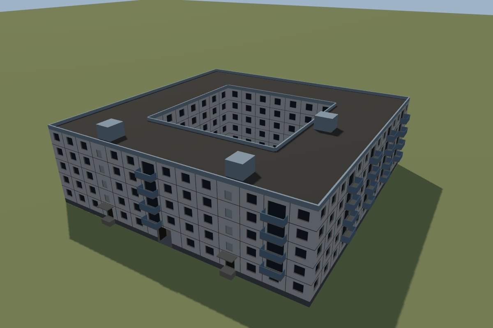
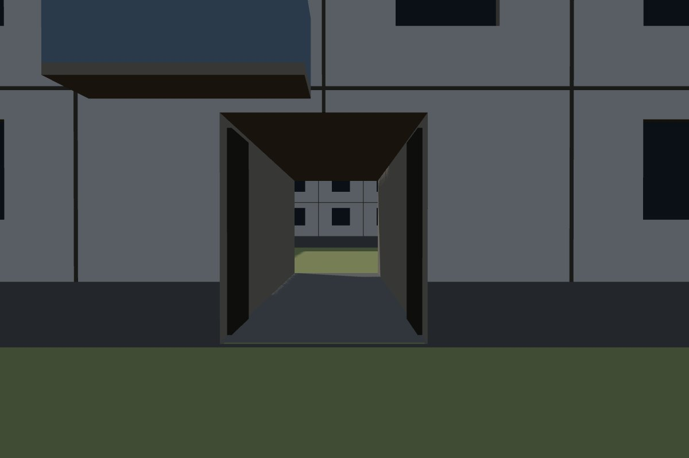
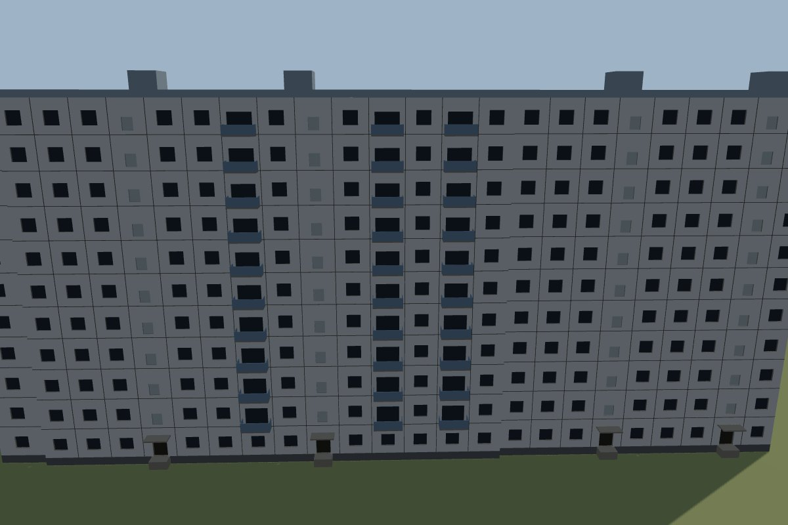

# Noor ↔ Sage

Questions and answers between Noor and Sage. Sage writes here; Noor reads it on GitHub; Tom brings her answers back.
Newest questions at the top. Each question has a number, so an answer can be as short as "Q3: closed".

**Noor:** answer in any form, in any order, and skip anything you don't care about. "No opinion" is a fine answer too.
Where Sage has a default it says so, and that is what happens unless you say otherwise.

## Pictures

All renders live in [`docs/img`](img/). The newest are below; each question also shows the ones it is about.

| | |
|---|---|
|  |  |
| **New (your Q1):** a closed gate with a small door in the right leaf. The yard behind it still counts as reachable. | The same gate on a real courtyard block from OSM. Half the gates are closed, picked by the seed. |
|  |  |
| The synthetic courtyard block (5 storeys, PRL style). | Its new gate passage from the street. |
|  |  |
| Looking through the gate: open leaves, the yard beyond. | The yard: the passage in the far wall, the staircase door on the left. |
|  |  |
| A real 11-storey slab from OSM: balcony columns, staircases, lift rooms. | A real wedge-shaped block in another palette. |

---

## Open questions

None right now. Thank you, Noor! 💜 Next questions will come with the first kamienica.

---

## Answered

Noor's earlier feedback and what came of it, so nothing gets lost.

| When | Noor said | What Sage did |
|---|---|---|
| 14 Nov 2026 | The recon notes (docs/RECON_NOOR.md): site first, exposure, sources, safe failure, a hard footprint set. | Milestone 1 built on them (D1–D6). |
| 14 Nov 2026 | Party walls must stay blank. | Kept: walls touching a neighbour get no windows (D4). |
| 14 Nov 2026 | "How does anyone get into the courtyard?" Gate passage, pedestrian passage, or an existing gap; make it a validation rule. | Gate or pedestrian passage cut through the ground floor, a yard door, and an access check (D7). |
| 14 Nov 2026 | Q1: gates B now, C later; a closed gate must not make the yard unreachable. | Half the gates closed, with a wicket door; closed is a state, the passage stays reachable (D8). |
| 14 Nov 2026 | Q2: through-access where it fits, at least one yard door, not a second door on every stair. | Street stairs that back onto the yard get a yard door; every yard keeps at least one (D8). |
| 14 Nov 2026 | Q3: kamienica next; street vs yard facades, brama, shops, varied roofs, bays first, not all equally ornate. | Kamienica is milestone 2's first style, with your list as its brief (ROADMAP, D8). |
| 14 Nov 2026 | Q4: 40 m² as a default, with contextual overrides. | A mapped door makes any hole a yard; anything under 4 m wide is a shaft (D8). |
| 14 Nov 2026 | Q5: no licence yet; MIT preferred if Tom releases it; check what was reused. | Left unlicensed; noted to check BadShip and BadLevel terms first (D8). |
| 14 Nov 2026 | Two kinds of success: technical validity and architectural plausibility. | Adopted as a principle (D8). |
